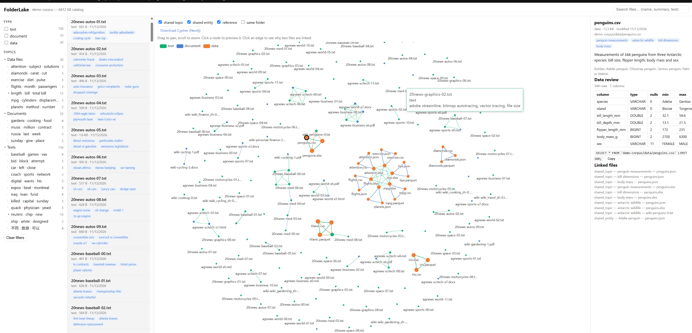
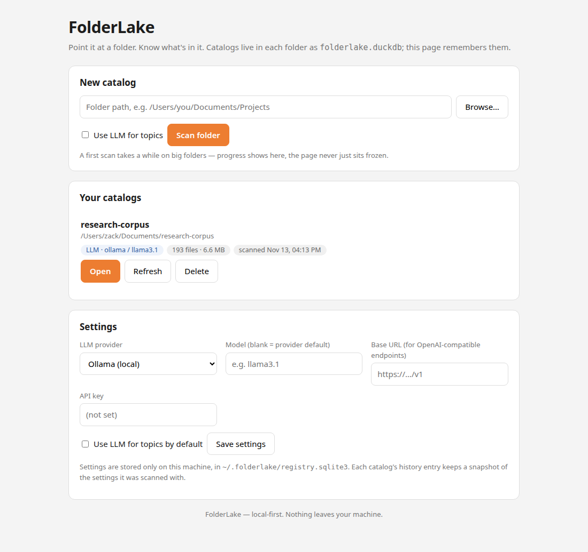

# FolderLake

**Point it at a folder. Know what's in it — an LLM reads the files,
and an MCP server lets your other agents query the result.**

FolderLake scans a folder once and builds a local catalog of every file
in it — **LLM topic tags, a one-line summary and key entities per
file**, plus a graph of how the files relate to each other. The
catalog is a single DuckDB file that lives next to your data. No
server, no account, nothing leaves your machine.

- **LLM topics** — plug in a model (Ollama local, OpenAI, Anthropic,
  any OpenAI-compatible endpoint) for phrase tags and real summaries;
  a built-in TF-IDF tagger covers folders with no model configured.
- **MCP built in** — `folderlake-mcp` exposes the catalog to Claude
  Code, Claude Desktop and other MCP clients: search, browse, inspect
  and traverse the graph without opening the UI.
- **Zero setup** — one `pip install`, one command, a web UI opens.
- **Fast** — 1,000 mixed files scan in ~13 s; rescans only touch new or
  changed files (~0.1 s when nothing changed).
- **Light** — a 1,000-file catalog is ~1.6 MB on disk.
- **Many formats** — txt, md, html, docx, pdf, csv, tsv, json, parquet,
  xlsx and sqlite out of the box.

## Live demo

**[Open the demo](https://daizack.github.io/FolderLake/)** — a real
FolderLake catalog of 193 public files (AG News, 20 Newsgroups, Wikipedia
articles and the seaborn datasets), browsable in your browser.

The demo's topic tags and summaries were generated by **Muse** (Meta's
AI assistant) acting as FolderLake's LLM tier — see
[How the demo was made](#how-the-demo-was-made). With no LLM configured,
FolderLake falls back to a built-in TF-IDF tagger; the demo shows what
the LLM tier adds: phrase tags like `car air conditioning` instead of
single words, and a real one-sentence summary per file.

Two things worth trying in the demo: click a topic in the tree — the
list and the graph filter together — and open the Wikipedia article
on the Titanic: it links straight to the Titanic passenger datasets.
FolderLake adds a *reference* link whenever a text names a dataset's
subject (a capitalised mention like "Titanic" or "Penguins"), on top
of shared topics, shared entities and explicit filename references.



## Quick start

```bash
pip install folderlake            # from PyPI (or: pip install -e . from a clone)

folderlake app                    # opens the FolderLake home page
```



That's the whole setup. `app` opens a home page in your browser right
away — no dialog, no waiting. Paste or browse to a folder, hit
**Scan folder**, and watch the progress bar; when the scan finishes
the catalog opens. Every catalog you build is remembered on the home
page (stored in a small SQLite registry in `~/.folderlake/`): reopen
one in a click, **Refresh** it to pick up added/removed files, or
**Delete** it. Each history entry shows the settings it was scanned
with. Inside a catalog, a **← FolderLake Home** link brings you back.
Everything runs on a single port — each catalog lives under its own
`/c/…/` path — so the app works through SSH tunnels, Docker port
mappings and other single-port forwarding.

The catalog viewer itself: filters and the topic tree on the left,
the file list and the relationship graph side by side in the middle
(on a phone they take turns, graph first), and a preview pane on the
right. Clicking a topic filters the list and the graph together.
Data files get a *data review* in the preview
pane — schema, null counts, min/max, approximate uniques — plus a
ready-to-run DuckDB query.

Prefer the terminal:

```bash
folderlake scan  ~/Documents/notes        # build or update the catalog
folderlake serve ~/Documents/notes        # rescan + open the viewer
folderlake cypher ~/Documents/notes       # export the graph as Neo4j Cypher
```

Every command is incremental: unchanged files are skipped by file stats
alone, so re-running on a big folder is cheap.

## Using an LLM for topics

With no LLM configured you get rule-based TF-IDF phrase tags. Point
FolderLake at any chat model and each new or changed file gets LLM tags,
a one-sentence summary and key entities instead (results are cached by
content hash, so each file is sent exactly once). In the app, the
home page's Settings card holds the same options — no environment
variables needed; the environment variables below remain for the
CLI and scripts:

```bash
pip install "folderlake[llm]"     # adds LiteLLM as the transport

# Local model via Ollama (default provider)
FOLDERLAKE_LLM_MODEL=qwen3 folderlake scan ~/notes --llm

# Any OpenAI-compatible endpoint (OpenAI, DeepSeek, Groq, LM Studio, vLLM…)
FOLDERLAKE_LLM_PROVIDER=openai \
FOLDERLAKE_LLM_MODEL=gpt-4o-mini \
FOLDERLAKE_LLM_API_KEY=sk-… \
  folderlake scan ~/notes --llm

# Anthropic
FOLDERLAKE_LLM_PROVIDER=anthropic \
FOLDERLAKE_LLM_MODEL=claude-haiku-4-5 \
FOLDERLAKE_LLM_API_KEY=sk-ant-… \
  folderlake scan ~/notes --llm
```

Data files are never sent raw: the LLM sees only a profile card
(`DESCRIBE` + `SUMMARIZE` output — column names and aggregate stats),
never sample row values. If the LLM is unreachable, the scan falls back
to rule topics and says so in its stats.

## Let other agents query it (MCP)

FolderLake ships an MCP server with six read-only tools — `stats`,
`search`, `list_files`, `file_detail`, `related`, `topics` — so any MCP
client (Claude Code, Cursor, your own agent) can ask questions about a
catalog without opening files:

```bash
pip install "folderlake[mcp]"
folderlake mcp ~/Documents/notes          # stdio MCP server
# or the folderlake-mcp entry point
```

## Tech stack

| Layer | Choice |
|---|---|
| Language | Python 3.11+, standard library first |
| Catalog store | **DuckDB** — one `.duckdb` file per scanned folder (files, topics, entities, relations, extracted text, topic tree) |
| Extraction | `python-docx`, `pypdf`, `openpyxl`, stdlib for txt/md/html/csv/json/sqlite; DuckDB itself reads parquet/csv |
| Rule topics | Corpus TF-IDF with phrase mining (English word bigrams, CJK bigrams/trigrams), title boost, boilerplate suppression |
| Topic tree | Agglomerative hierarchical clustering over TF-IDF, per file kind; labels by term lift; rendered as a collapsible tree |
| LLM tier | Provider layer over **LiteLLM** (optional extra) with a built-in client as fallback — Ollama, OpenAI-compatible, Anthropic, Hugging Face |
| Viewer | One HTML file, vanilla JS + **Apache ECharts** 5.5.1 (vendored, the only JS dependency), served by stdlib `http.server`; responsive down to phone widths |
| Graph export | Idempotent Neo4j Cypher (`MERGE` script) |
| Agent access | Official `mcp` Python SDK (optional extra), stdio transport |
| App state | SQLite registry (stdlib `sqlite3`) in `~/.folderlake/registry.sqlite3` — catalog history with per-scan settings snapshots, plus the user settings |
| Tests | pytest — 59 tests covering extractors, topics, relations, hierarchy, server and MCP |

### The ML / NLP pipeline, briefly

- **Tokenization** — English unigrams + word bigrams; Chinese character
  bigrams/trigrams; data files contribute joined column-name phrases
  (`total_bill` → "total bill").
- **Phrase mining** — candidate tags are scored with TF-IDF (smoothed
  IDF, title/filename boost ×3, phrase-length bonus); a phrase's
  component words are suppressed so tags read like `car air
  conditioning`, not `car`, `air`, `conditioning`.
- **LLM classification** — with a model configured, each file's
  "hotspot" segments (~10k chars: opening, densest passages, closing)
  go to the model, which returns structured JSON (tags / summary /
  entities); results are cached by content hash. Data files are
  described by schema + profile statistics only — sample values never
  reach the topic model.
- **Topic tree** — per-kind agglomerative hierarchical clustering
  (centroid linkage, cosine over L2-normalized TF-IDF vectors, corpus
  document-frequency hygiene); node labels are picked by term *lift*
  against the whole kind, and "forced marriage" nodes whose halves
  barely resemble each other are flattened away.
- **Entities** — capitalized-sequence extraction (≥2 mentions) in the
  rule tier; the model's entity list in the LLM tier.
- **Embeddings** — deliberately not used anywhere; see
  [Limitations](#limitations-honestly).

## Demo data

The 193 files in the live demo are public material, assembled to look
like a real mixed folder:

| Kind | Count | Source |
|---|---|---|
| Texts | 130 | Posts sampled from the **20 Newsgroups** corpus, plus **Wikipedia** article excerpts (English and Chinese), as `.txt` |
| Documents | 33 | **AG News** articles packaged as `.pdf` / `.docx` / `.html`, plus longer Wikipedia articles |
| Data | 30 | The 10 **seaborn** example datasets (tips, iris, penguins, titanic, diamonds, flights, mpg, planets, exercise, attention), each in 3 formats (CSV / JSON / Parquet or XLSX) |

Two Wikipedia leads — *RMS Titanic* and *Penguin* — are included on
purpose: they are what the Titanic and penguins datasets are *about*,
so the demo contains genuine text→data links.

Wikipedia text is CC BY-SA; 20 Newsgroups and AG News are standard
public research corpora; the seaborn datasets ship with the
BSD-licensed seaborn library. The corpus itself is not distributed
with this repository — only the rendered catalog snapshot is
published, and articles are trimmed to excerpts.

## How the demo was made

The live demo is a static snapshot of a real catalog, produced like
this (all steps reproducible from this repo):

1. A 193-file corpus of public datasets was scanned with
   `folderlake scan --llm`.
2. The "LLM" was **Muse**, served through the stub in
   [`tools/llm_stub.py`](tools/llm_stub.py): it answers FolderLake's
   ordinary OpenAI-compatible requests with responses Muse authored
   for each file — so the demo exercises the real provider layer,
   prompt packaging, JSON parsing and hash caching, with Muse as the
   model. The scan stats reported `llm: 193, rule: 0`.
3. The viewer was snapshotted to a single self-contained HTML file
   (kept in [`demo/`](demo/) in this repo), which GitHub Actions
   deploys to GitHub Pages on every push that touches it.

To recreate the sample folder from the screenshots in early docs:

```bash
python tools/make_demo_folder.py   # writes ./demo_folder (bike shop + garden)
```

## Benchmarks

Measured in a small shared-CPU sandbox VM (absolute numbers will be
better on a real machine; treat them as a floor):

| Operation | Result |
|---|---|
| Full scan, 1,000 mixed files (rule topics) | 12.6 s, catalog 1.59 MB |
| Incremental rescan, nothing changed | 0.09 s |
| Full scan, 2,000 files (topic pipeline v2) | ~38 s |
| Topic tree build, 193 files | ~1.5 s |

## Limitations, honestly

- Relations grow quadratically before deduplication — very large
  folders (5,000+ files) get heavy graph tables; per-tag edge budgets
  are planned but not yet shipped.
- The topic tree is built for kinds with at most 400 files (the
  clustering is O(N²)); larger kinds keep flat topic facets.
- Search uses a `LIKE` fallback when DuckDB's FTS extension is
  unavailable.
- Embeddings are deliberately **not** a dependency: if they are added,
  they will arrive through the same provider layer as the LLM tier,
  never as a bundled torch install.

## Development

```bash
pip install -e ".[llm,mcp]"
pytest                            # 59 tests
```

Demo data: see [Demo data](#demo-data) above.

## License

MIT — see [LICENSE](LICENSE).
